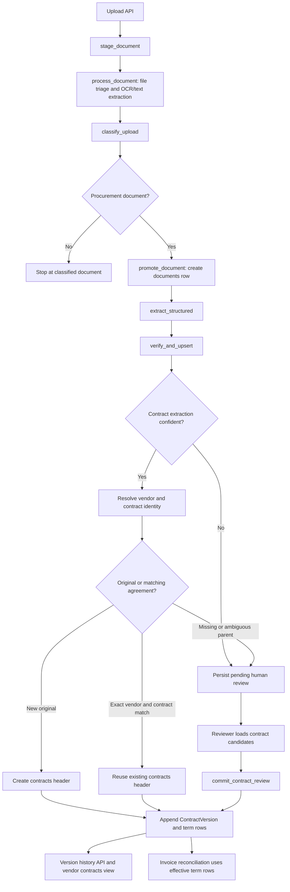

# Contract Versioning: Execution Flow Across the Codebase

This guide follows a contract document from upload through processing, identity resolution, and version storage. It also shows the human-review path used when the pipeline cannot safely determine the parent agreement or product line.

The product requirement is that commercial contract terms be versioned rather than overwritten ([PRD, contract-versioning requirement](PRD.md)).

## At a glance



The OCR and structured extraction steps are distinct. `process_document` extracts document text and persists an extraction artifact. The later `extract_structured` task extracts fields such as vendor, contract number, dates, and terms for ledger processing.

## 1. Upload, OCR, and classification

1. The uploads router accepts the file and calls `_enqueue_stage_document` in [`uploads.py`](backend/services/ingestion-api/src/zellovest_ingestion/api/routers/uploads.py). That helper enqueues the worker task `stage_document`.
2. `stage_document` in [`document_ocr.py`](backend/services/workers/src/zellovest_workers/tasks/document_ocr.py) marks the upload as processing and enqueues `process_document`.
3. `process_document` downloads the file, triages its format, extracts text/OCR, persists the extraction artifact, and enqueues `classify_upload`.
4. `classify_upload` in [`document_classify.py`](backend/services/workers/src/zellovest_workers/tasks/document_classify.py) classifies the document. For invoices, purchase orders, contracts, and amendments, it enqueues `promote_document`.
5. `promote_document` in [`document_promote.py`](backend/services/workers/src/zellovest_workers/tasks/document_promote.py) creates the structured `documents` row and enqueues `extract_structured`.

The calls are asynchronous Celery task handoffs. A returned task ID means the next stage was queued; it does not mean all later stages have finished.

```python
# document_classify.classify_upload (simplified)
promote_result = promote_document.delay(
    tenant_id=tenant_id,
    upload_id=upload_id,
    document_type=result.doc_type,
    filename=effective_filename,
    gcs_key=artifact.source_gcs_key,
)
```

## 2. Structured extraction and automatic ledger path

`extract_structured` in [`document_structured_extract.py`](backend/services/workers/src/zellovest_workers/tasks/document_structured_extract.py) loads the promoted document, extracts structured fields, then enqueues `verify_and_upsert` in [`document_verify.py`](backend/services/workers/src/zellovest_workers/tasks/document_verify.py).

For contract and amendment documents, `verify_and_upsert` verifies the extracted data. If confidence is sufficient, it resolves the vendor and calls `_upsert_contract`:

```python
# document_verify.verify_and_upsert (simplified)
entity_id = _upsert_contract(
    session,
    tenant_id=tenant_id,
    document_id=doc_key,
    document_type=document_type,
    data=extracted_data,
    vendor_id=vendor_id,
)
```

`_upsert_contract` applies the identity decision:

- It checks for an already-created version sourced from this document, making worker retries idempotent.
- For a new original, it creates one `contracts` row for the logical agreement.
- For an amendment, renewal, or price revision, it looks for a contract with the same tenant, canonical vendor, and normalized contract number. A unique match reuses that `contracts` row.
- If an amendment has no unique parent, or product lines cannot be mapped unambiguously, it raises `ContractReviewRequired`. The worker persists a pending review instead of inventing a parent relationship.

The version append path creates a `contract_versions` header linked to its source `documents` row and parent version. It matches incoming terms to stable `contract_lines`, copies unchanged terms into the new effective snapshot, closes prior validity windows where terms change, and inserts the changed or added terms into `contract_terms_versioned`.

## 3. Human-review path

Low-confidence contract extraction is saved as pending review by `_persist_contract_review` in `document_verify.py`. A high-confidence amendment that has an unresolved parent or line mapping is also sent to this review state.

The review UI uses the ingestion API endpoints in [`documents.py`](backend/services/ingestion-api/src/zellovest_ingestion/api/routers/documents.py):

1. `GET /v1/documents/{document_id}/contract-candidates` calls `get_contract_candidates` to return tenant contracts and their latest term lines.
2. The reviewer chooses the parent, selects the event type, maps extracted terms to stable product lines, and can mark lines for removal.
3. `POST /v1/documents/{document_id}/review/commit` calls `commit_contract_review`. It validates the selected parent and appends the version through `_append_contract_version` in the same database transaction as the review receipt and human-verified provenance.

If a reviewer selects a parent, the submitted event must be an amendment, renewal, or price revision. If the source document or product-line match is still ambiguous, the commit returns a conflict for the reviewer to correct.

## 4. How the records fit together

The schema is defined in [`transact.py`](backend/shared/src/zellovest_shared/db/transact.py) and introduced/backfilled by [`0016_contract_version_lineage.py`](backend/alembic/versions/0016_contract_version_lineage.py).

| Record | Represents |
| --- | --- |
| `documents` | A processed source file, such as the original agreement or an amendment PDF. |
| `contracts` | The logical agreement. Its row is reused across amendments. |
| `contract_versions` | Each source-backed event in the agreement lineage: original, amendment, renewal, or price revision. |
| `contract_lines` | Stable identity for a product or pricing tier across versions. |
| `contract_terms_versioned` | Effective commercial values for a product line in a version, including price, currency, quantity limits, discounts, tax rule, payment, and freight terms. |

For example, a contract with five product lines normally has five term rows in its original version. An amendment changing one line creates a new version snapshot: the other four lines are carried forward and the changed line gets new effective terms. The original and amendment still produce two `documents` rows, but they share one `contracts` row and have separate `contract_versions` rows.

## 5. Reading history and invoice use

The procurement router in [`contracts.py`](backend/services/procurement-core/src/zellovest_procurement/api/routers/contracts.py) provides:

- `GET /contracts/{contract_id}/history` through `get_contract_history`, returning versions, parent links, source-file information, and term rows.
- `GET /vendors/{vendor_id}/contracts` through `list_vendor_contract_lines`, returning the latest snapshot's product lines for the vendor contracts page.

After an invoice is committed or automatically upserted, the worker enqueues `reconcile_invoice` in [`ap_audit.py`](backend/services/workers/src/zellovest_workers/tasks/ap_audit.py). It uses the invoice date, vendor, product identity, quantity limits, and currency to find applicable term rows. Exceptions reference both the `contract_versions` header and the precise `contract_terms_versioned` row, preserving which terms were used for the comparison. Missing or ambiguous matches are marked for review rather than compared against an arbitrary version.

## Key implementation locations

- Upload and OCR entry: [`uploads.py`](backend/services/ingestion-api/src/zellovest_ingestion/api/routers/uploads.py) → [`document_ocr.py`](backend/services/workers/src/zellovest_workers/tasks/document_ocr.py)
- Classification and promotion: [`document_classify.py`](backend/services/workers/src/zellovest_workers/tasks/document_classify.py) → [`document_promote.py`](backend/services/workers/src/zellovest_workers/tasks/document_promote.py)
- Structured extraction and identity/version write: [`document_structured_extract.py`](backend/services/workers/src/zellovest_workers/tasks/document_structured_extract.py) → [`document_verify.py`](backend/services/workers/src/zellovest_workers/tasks/document_verify.py) → [`documents.py`](backend/services/ingestion-api/src/zellovest_ingestion/api/routers/documents.py)
- Versioned schema: [`transact.py`](backend/shared/src/zellovest_shared/db/transact.py) and [`0016_contract_version_lineage.py`](backend/alembic/versions/0016_contract_version_lineage.py)
