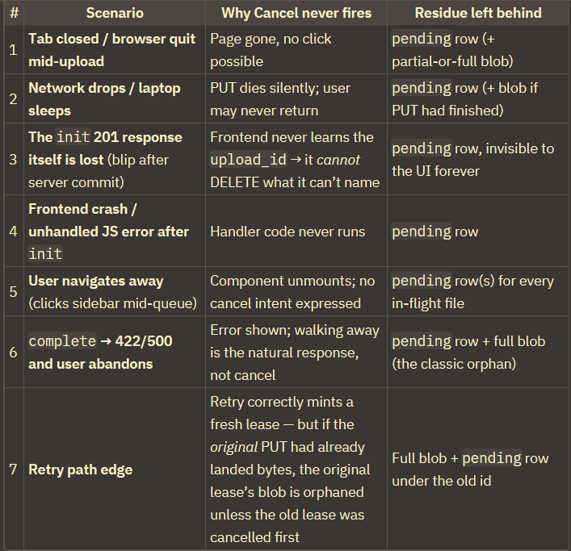

# Zellovest

Here the first user is assigned access to the system via CLI seed script. Then this user can invite other users.

### Frontend

In frontend/src/ — this is a Next.js App Router project — those 5 folders each have one job. Think of building a house:

1. **app/ — rooms / pages (URLs)**

In Next.js, folder = URL.
app/page.tsx → / (home dashboard)
app/vendors/ → /vendors, app/renewals/ → /renewals, app/login/ → /login, app/upload/, app/assistant/, app/maverick-spend/ etc.
app/layout.tsx → the outer frame for all pages: loads font, globals.css, wraps everything in <AppProviders> + <AuthGuard> + <ShellGate> + <ToastContainer>. So login check + sidebar shell + popups work everywhere.
If you want a new page, you add a folder here.

2. **components/ — reusable bricks**

Small UI pieces used by many pages, so you don’t copy-paste:
ui/ → buttons, toasts, modals
layout/ → sidebar, header, ShellGate
auth/ → AuthGuard (blocks pages if not logged in)
vendors/, upload/ → vendor cards, file-drop zone
Example: ToastContainer rendered once in layout.tsx displays toasts from anywhere.

3. **contexts/ — global memory**

React Context = data every page needs without passing props down manually.
AuthContext.tsx → user, login(), logout(), isAuthenticated — restores JWT from localStorage, calls POST /api/v1/auth/login.
ToastContext.tsx → notify.success/error(...) — any component can pop a message.
LayoutContext.tsx → isSidebarCollapsed, toggleSidebar() — sidebar open/close state.
AppProviders.tsx → just nests them: Auth > Toast > Layout > children, so order is fixed.

4. **lib/ — tools / phone lines to backend**

Plain helper functions, no UI:
api.ts → useApi() hook: fetch(${API_BASE}/vendors...), auto-adds Authorization: Bearer <token>, has vendors.list/get/create, contracts.*, documents.upload(), and uploads.init/putBytes/complete for direct-to-GCS upload. All pages call this instead of raw fetch.
auth.ts → token save/load/clear helpers.

5. **types/index.ts — dictionary / contract**

Like Pydantic in FastAPI, but for TypeScript. Defines shapes once:
UserSession, AuthContextType, Vendor, Contract, Invoice, CardTransaction, Document, UploadFile, ToastNotification...
So api.ts returns Promise<Vendor[]>, components receive vendor: Vendor — if backend changes a field, TypeScript shouts here instead of crashing at runtime.
Flow: app/vendors/page.tsx → useAuth() from contexts/ for token → useApi().vendors.list() from lib/ → types checked via types/ → rendered with bricks from components/.

### Celery beat

Situations when celery beat is needed to act like janitor cleaning up db rows in uploads table with pending status that has past the expiry time.




### Future improvements needed for manual upload:

1. Manual file upload - When user clicks cancel, once the file is completely uploaded to GCS bucket, but before /upload/{upload_id}/complete endpoint, that object remains in the bucket, not deleted. Handle this

2. Set up celery beat as janitor to clean up the mess of pending status db inserts in uploads table that has passed expiry limit.

3. Handle growing table 'ingestion_sync_checkpoint'. I think, only pending tasks should remain. Succeeded and failed tasks should be removed within a day.


### GET /uploads/{id} :
Imagine you upload Resume_Zameer_U.pdf. Here’s the file’s journey, and what the endpoint says at each stop. ({id} is the upload_id from step 1 — think of it as the file’s tracking number.)

Step 1 — You drop the file. Frontend calls POST /uploads/init → backend replies 201 with a tracking number, say caeb847a…. A row is written in the database: status = pending (“we’re waiting for the bytes”).

Step 2 — Bytes fly to Google. The browser PUTs the PDF straight to GCS. Nobody asks the backend anything during this.

Step 3 — Your code asks: “did it arrive?” Frontend calls POST /uploads/{id}/complete. Backend checks GCS, flips the row to staged (“bytes verified, worker notified”), and a background worker picks it up (processing), then finishes extraction (completed) — or something breaks (failed).

Now the problem this endpoint solves: after step 3, the frontend is staring at a row that says “Processing…” — but is the worker actually working? Done? Crashed 5 minutes ago? The frontend can’t know, because everything after complete happens silently in the background.

So it asks, every 3 seconds:

"GET /uploads/caeb847a… → “status: processing”
GET /uploads/caeb847a… → “status: processing”
GET /uploads/caeb847a… → “status: completed” ✅ → UI flips to ✓ Done
"

And if things went wrong instead:

'GET /uploads/caeb847a… → “status: failed, error: blob absent from GCS” → UI shows ✗ with that exact reason.'

##### Why not avoid it
Without it, the UI has two bad options after complete: freeze on “Processing…” forever (user has no idea if extraction worked), or blindly declare “Done” the moment bytes land in GCS (declaring victory before extraction even starts — which is what the old simulated UI did).

# Local RAG services

The microservice Compose stack includes a persistent Qdrant container. Copy
`backend/.env.example` to `backend/.env`, configure `VOYAGE_API_KEY`,
`GROQ_API_KEY`, and (optionally) the Langfuse Cloud keys, then start the stack
from `backend/`:

```powershell
docker compose -f docker-compose.microservices.yml --env-file .env up --build -d
```

After PostgreSQL is ready, apply migrations from `backend/` with
`uv run alembic upgrade head`.

Qdrant is available on `http://localhost:6333` and its dashboard at
`http://localhost:6333/dashboard`. The agentic service and document worker use
the Compose service URL (`http://qdrant:6333`). FastEmbed downloads its BM42
model on first indexing/search, so the first operation can take longer.
The `worker-documents` service is required for uploads to reach Qdrant; Qdrant
alone only runs the database. Uploads stay in `processing` until indexing
finishes, then move to `completed`; exhausted indexing retries mark them
`failed`. The worker logs `rag_index_enqueued` and
`rag_index_task_completed` with the document id and passage count.

## Ask AI document research UI

Open `/assistant` in the frontend to ask questions about indexed contracts,
amendments, policies, invoices, purchase orders, and other uploaded documents,
or search for source passages. Use the vendor selector to scope both views.
Answers include citations that link back to their source documents.
The frontend proxies `/api/agentic/*` to the agentic service on
`http://localhost:8002` by default. This requires the agentic FastAPI service
to be running as well as Qdrant; Qdrant alone does not expose the Ask AI API.
Set `AGENTIC_API_URL` in `frontend/.env.local` if Next.js cannot reach the
service at localhost (for example, use `http://agentic-reasoning:8002` when
both services run in the same Docker network). A proxy connection failure is
returned as HTTP 502 with a setup hint.

RAG uses Groq's `openai/gpt-oss-120b` by default when `GROQ_API_KEY` is set.
Override the model with `GROQ_MODEL`; leave `RAG_EVALUATOR_MODEL` blank to
evaluate with the same model.

The agentic service reads `LANGFUSE_PUBLIC_KEY`, `LANGFUSE_SECRET_KEY`, and
`LANGFUSE_BASE_URL` from `backend/.env`; the Compose service also receives that
file through `env_file`. Traces contain operation metadata and token usage,
not prompts or source document text. Restart or recreate the agentic service
after changing these settings. Use the base URL for the region where your
Langfuse project is hosted.

`POST /api/v1/rag/search` and `/api/v1/ask-ai` require the normal user bearer
token. `POST /api/v1/rag/evaluate` generates questions from indexed contract
passages and uses the configured evaluator model to score relevance,
faithfulness, citation support, and evidence coverage. It does not use a fixed
gold-answer set. Evaluation prompts and document text go to the configured LLM
provider but are excluded from Langfuse; traces record metadata and token
usage only.

In Langfuse's Tracing/Observations view, Ask AI requests appear as one
`ask_ai.query` trace with nested `ask_ai.document_retrieval` and
`ask_ai.grounded_generation` spans; the provider call appears as a nested
`rag.llm_call` generation. Direct passage searches appear as
`rag.hybrid_search` traces. Each trace carries a `request_id`; the same ID is
returned in the `X-Request-Id` response header and included in FastAPI logs.
Prompts and source passages are intentionally omitted from traces. Langfuse
ingestion is asynchronous, so a new trace may take a short time to appear.

For a local MCP client, install the agentic-reasoning service dependencies,
set `ZELLOVEST_TENANT_ID` in the MCP server process environment, and launch
`python -m zellovest_agentic.mcp.document_knowledge` with the agentic service
`src/` and shared package on `PYTHONPATH`. The stdio server takes tenant scope
from that server environment; MCP tool arguments cannot choose another tenant.
