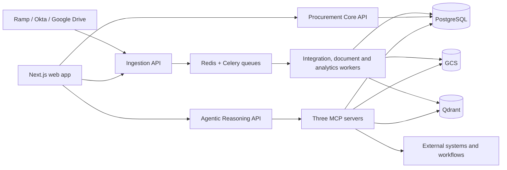

# Zellovest

**Procurement intelligence that connects what a company buys, what it uses, and what its contracts promise.**

Zellovest helps procurement teams at mid-market companies understand and control software and vendor spending. It connects card transactions, application usage, contracts, invoices, purchase orders, and vendor documents into one view of each vendor. Teams can identify waste, investigate billing issues, prepare for renewals, and ask questions with evidence behind the answers.

## The problem and its business impact

Procurement information is scattered across finance tools, identity systems, cloud drives, and spreadsheets. A payment can look reasonable in isolation while duplicating an existing subscription, paying for inactive users, or violating a contract amendment. Finding these connections manually takes time, and renewal deadlines can pass before anyone acts.

| Company problem | How Zellovest addresses it | Intended business impact |
| --- | --- | --- |
| Employees buy software outside procurement | Detect recurring SaaS purchases in Ramp transactions and find overlap with approved tools | Reduce duplicate subscriptions and unmanaged spending |
| Companies renew more licenses than they need | Use Okta activity to identify inactive seats and forecast renewal demand | Reduce unused licenses while accounting for the cost of buying extra seats later |
| Invoices differ from agreed commercial terms | Compare invoice lines with applicable contract versions and purchase orders | Identify overcharges and contract compliance issues |
| Renewal dates and clauses are buried in documents | Extract notice periods and renewal terms; prepare reminders and negotiation briefs | Give buyers time and evidence to negotiate |
| Investigations require searching several systems | Combine vendor records with document search and an Ask AI assistant | Reduce manual research and make findings traceable |

For example, an invoice charging $140 for each of 100 seats against an applicable $120 contract rate represents a $2,000 discrepancy to investigate. Zellovest connects the calculation to the relevant terms so procurement can review the evidence and decide what to do. Identified opportunities remain potential savings until verified.

## System design



The backend has three FastAPI services: **ingestion-api** handles integrations and uploads; **procurement-core** manages vendor records, analytics, and workflows; **agentic-reasoning** coordinates Ask AI, investigations, and negotiation preparation. Celery workers process slow jobs, while Celery Beat schedules recurring work.

**Document flow:** Drive imports or manual uploads place files in Google Cloud Storage (GCS). Workers extract text and tables, classify documents, map business fields, and verify results, with human review when needed. Structured records go to PostgreSQL; document passages and their source metadata are indexed in Qdrant for search.

**Question flow:** Ask AI plans the request and calls three Model Context Protocol (MCP) servers: **Procurement Intelligence** for structured facts and calculations, **Document Knowledge** for passages and provenance, and **External Systems & Actions** for controlled workflows. It combines the results into an answer with citations and data gaps, with progress streamed to the browser using Server-Sent Events (SSE).

**Forecasting flow:** Okta activity becomes raw, cleaned, and model-ready features in BigQuery. Vertex AI runs LightGBM training and calibration; approved model artifacts are stored in GCS and loaded by Celery for batch forecasts. A deterministic optimizer balances unused-seat costs against extra-seat penalties to recommend a renewal commitment.

## Technologies

| Layer | Technologies and purpose |
| --- | --- |
| Web application | Next.js, React, TypeScript; procurement screens, conversational UI, and PDF evidence review |
| APIs | Python 3.11+, FastAPI, Pydantic; validated request and response contracts |
| Operational data | PostgreSQL 16, SQLAlchemy, Alembic; vendor relationships, versioned terms, workflow state, and schema migrations |
| Background processing | Celery, Celery Beat, Redis; separate ingestion, document, and analytics queues |
| Document processing | PyMuPDF, pdfplumber, Google Cloud Document AI, GCS; digital PDF parsing, OCR, and file/artifact storage |
| AI and tool access | Groq for extraction and reasoning, Jev (TypeSafe AI) for typed probabilistic decisions, MCP for scoped tools; configurable OpenAI/Anthropic answer providers |
| Retrieval | Qdrant, Voyage dense embeddings, FastEmbed sparse embeddings; hybrid document retrieval and separate software capability matching |
| Forecasting | LightGBM, scikit-learn, pandas, BigQuery, Vertex AI; usage features, calibrated retention predictions, training, and evaluation |
| Delivery and visibility | Docker Compose, Traefik, GitHub Actions, structlog, optional Langfuse; reproducible services, HTTPS ingress, image delivery, structured logs, and AI tracing |

## Why the system is designed this way

1. **Dedicated deployment per company.** Customer databases, files, and search indexes stay within an isolated deployment. This supports privacy and customer-specific operations, at the cost of more infrastructure per customer. The PRD targets 500–1,000 active users per instance; this is a capacity target requiring load validation.
2. **A small number of services.** Ingestion, operational workflows, and AI reasoning have different workloads and failure modes. Separate APIs and workers allow independent scaling, while shared Python models and a shared operational database keep development manageable. Schema changes still require coordination.
3. **Asynchronous processing.** Files live in object storage and queues carry references rather than document bytes. Separate queues, retries, and sync checkpoints keep long extraction and analytics jobs off the request path and help control duplicate processing.
4. **Extract once, calculate with rules.** Digital PDFs use Python parsers; scanned documents use cloud OCR. Extracted commercial terms are persisted and versioned so invoices can be checked against the terms effective at that time. Financial calculations use deterministic rules and decimal arithmetic; AI handles interpretation and investigation.
5. **Evidence accompanies answers.** Hybrid retrieval combines semantic meaning with keyword matching. Document, page, confidence, and available layout coordinates support source inspection. Document search and software capability matching use separate collections because they answer different questions.
6. **Tools enforce authority.** The agent uses narrowly scoped MCP tools with verified deployment and user context. Tool calls are audited, uncertain extractions can enter human review, and consequential actions require explicit human confirmation tied to the proposed operation and parameters.

## Run locally

Use Docker Desktop. Create `backend/.env` from [the example configuration](backend/.env.example), then configure authentication secrets, the GCP credential file and buckets, and provider keys for the features you want to use. Set OAuth callback URLs for your local services. Cloud integrations require their corresponding accounts and permissions.

```powershell
cd backend
docker compose --parallel 1 -f docker-compose.develop.yml up --build -d
```

The development app opens at [localhost:3001](http://localhost:3001). Database migrations run automatically. Create the first procurement member from a second terminal in `backend/` (the script prompts for a password):

```powershell
docker compose -f docker-compose.develop.yml run --rm -v ./scripts:/app/scripts:ro migrate python scripts/seed_user.py --name "Your Name" --email you@company.com
```

Additional members join through invitations. The production Compose configuration uses published images and Traefik; use the development file above when building locally.

## Further reading

- [PRD](PRD.md): product vision, business rules, and full feature scope.
- [Module map](MODULES.md) and [backend services](backend/services/README.md): responsibilities and service layout.
- [Document processing flow](docs/google-drive-document-processing-flow.md): ingestion through extraction and verification.
- [RAG operations](docs/rag-operations.md) and [retrieval benchmark](docs/rag-benchmark.md): indexing, retrieval, and quality evaluation.
- [Forecasting and delivery](backend/services/workers/README.md): model lifecycle and deployment configuration.
