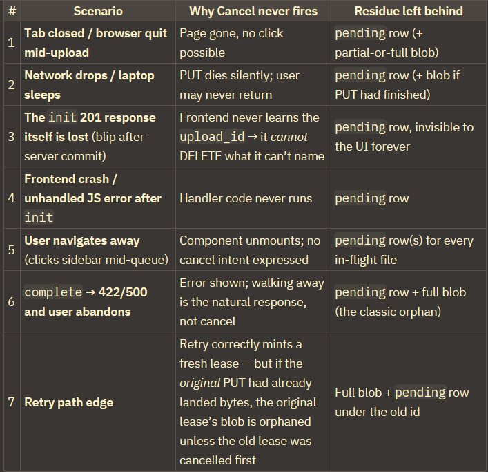

# Zellovest

Here the first user is assigned access to the system via CLI seed script. Then this user can invite other users.

### Frontend

In frontend/src/ — this is a Next.js App Router project — those 5 folders each have one job. Think of building a house:

1. **app/ — rooms / pages (URLs)**

In Next.js, folder = URL.
app/page.tsx → / (home dashboard)
app/vendors/ → /vendors, app/renewals/ → /renewals, app/login/ → /login, app/upload/, app/assistant/, app/maverick-spend/ etc.
app/layout.tsx → the outer frame for all pages: loads font, globals.css, wraps everything in <AppProviders> + <AuthGuard> + <ShellGate> + <ToastContainer>. So login check + sidebar shell + popups work everywhere.
If you want a new page, you add a folder here.

2. **components/ — reusable bricks**

Small UI pieces used by many pages, so you don’t copy-paste:
ui/ → buttons, toasts, modals
layout/ → sidebar, header, ShellGate
auth/ → AuthGuard (blocks pages if not logged in)
vendors/, upload/ → vendor cards, file-drop zone
Example: ToastContainer rendered once in layout.tsx displays toasts from anywhere.

3. **contexts/ — global memory**

React Context = data every page needs without passing props down manually.
AuthContext.tsx → user, login(), logout(), isAuthenticated — restores JWT from localStorage, calls POST /api/v1/auth/login.
ToastContext.tsx → notify.success/error(...) — any component can pop a message.
LayoutContext.tsx → isSidebarCollapsed, toggleSidebar() — sidebar open/close state.
AppProviders.tsx → just nests them: Auth > Toast > Layout > children, so order is fixed.

4. **lib/ — tools / phone lines to backend**

Plain helper functions, no UI:
api.ts → useApi() hook: fetch(${API_BASE}/vendors...), auto-adds Authorization: Bearer <token>, has vendors.list/get/create, contracts.*, documents.upload(), and uploads.init/putBytes/complete for direct-to-GCS upload. All pages call this instead of raw fetch.
auth.ts → token save/load/clear helpers.

5. **types/index.ts — dictionary / contract**

Like Pydantic in FastAPI, but for TypeScript. Defines shapes once:
UserSession, AuthContextType, Vendor, Contract, Invoice, CardTransaction, Document, UploadFile, ToastNotification...
So api.ts returns Promise<Vendor[]>, components receive vendor: Vendor — if backend changes a field, TypeScript shouts here instead of crashing at runtime.
Flow: app/vendors/page.tsx → useAuth() from contexts/ for token → useApi().vendors.list() from lib/ → types checked via types/ → rendered with bricks from components/.

### Celery beat

Situations when celery beat is needed to act like janitor cleaning up db rows in uploads table with pending status that has past the expiry time.

### Future improvements needed for manual upload:

1. Manual file upload - When user clicks cancel, once the file is completely uploaded to GCS bucket, but before /upload/{upload_id}/complete endpoint, that object remains in the bucket, not deleted. Handle this

2. Set up celery beat as janitor to clean up the mess of pending status db inserts in uploads table that has passed expiry limit.

### GET /uploads/{id} :
Imagine you upload Resume_Zameer_U.pdf. Here’s the file’s journey, and what the endpoint says at each stop. ({id} is the upload_id from step 1 — think of it as the file’s tracking number.)

Step 1 — You drop the file. Frontend calls POST /uploads/init → backend replies 201 with a tracking number, say caeb847a…. A row is written in the database: status = pending (“we’re waiting for the bytes”).

Step 2 — Bytes fly to Google. The browser PUTs the PDF straight to GCS. Nobody asks the backend anything during this.

Step 3 — Your code asks: “did it arrive?” Frontend calls POST /uploads/{id}/complete. Backend checks GCS, flips the row to staged (“bytes verified, worker notified”), and a background worker picks it up (processing), then finishes extraction (completed) — or something breaks (failed).

Now the problem this endpoint solves: after step 3, the frontend is staring at a row that says “Processing…” — but is the worker actually working? Done? Crashed 5 minutes ago? The frontend can’t know, because everything after complete happens silently in the background.

So it asks, every 3 seconds:

"GET /uploads/caeb847a… → “status: processing”
GET /uploads/caeb847a… → “status: processing”
GET /uploads/caeb847a… → “status: completed” ✅ → UI flips to ✓ Done
"

And if things went wrong instead:

'GET /uploads/caeb847a… → “status: failed, error: blob absent from GCS” → UI shows ✗ with that exact reason.'

##### Why not avoid it
Without it, the UI has two bad options after complete: freeze on “Processing…” forever (user has no idea if extraction worked), or blindly declare “Done” the moment bytes land in GCS (declaring victory before extraction even starts — which is what the old simulated UI did).

